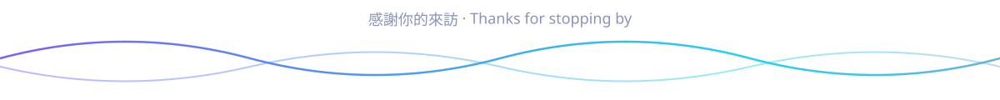

<!-- 橫幅：會依 GitHub 的深色／淺色主題自動切換 -->
<picture>
  <source media="(prefers-color-scheme: dark)" srcset="./assets/banner-dark.svg">
  <source media="(prefers-color-scheme: light)" srcset="./assets/banner-light.svg">
  
</picture>

<p align="center">
  <a href="https://github.com/tengyao-pobo?tab=repositories"></a>
  <a href="https://github.com/tengyao-pobo?tab=followers"></a>
  
</p>

## 👋 關於我

我是 POBO，習慣**和 AI 協作**來做東西。
我負責提出想法、決定方向、把關品質；AI 是我的搭檔，一起把想法實作出來。

```text
💡 想法  ──▶  🤖 與 AI 協作實作  ──▶  🔍 審視與調整  ──▶  🚀 發布
```

## 🐍 貢獻足跡

<picture>
  <source media="(prefers-color-scheme: dark)" srcset="https://raw.githubusercontent.com/tengyao-pobo/tengyao-pobo/output/snake-dark.svg">
  <source media="(prefers-color-scheme: light)" srcset="https://raw.githubusercontent.com/tengyao-pobo/tengyao-pobo/output/snake-light.svg">
  
</picture>

<picture>
  <source media="(prefers-color-scheme: dark)" srcset="./assets/footer-dark.svg">
  <source media="(prefers-color-scheme: light)" srcset="./assets/footer-light.svg">
  
</picture>
